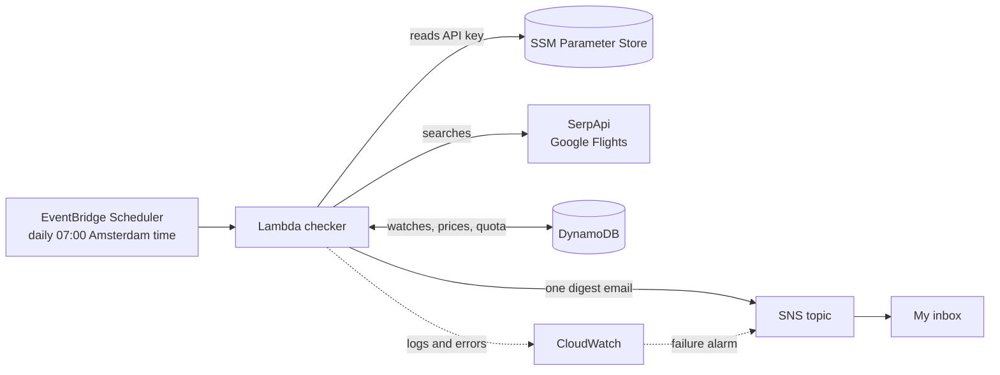

# Flight Price Tracker: Amsterdam → Lahore

A serverless AWS application that watches flight prices from **Amsterdam (AMS)** to **Lahore (LHE)** every day, stores the price history, and sends me **one email** when a date drops below my price.

Built with **Python, AWS Lambda, EventBridge Scheduler, DynamoDB, SNS and SAM**, using the **SerpApi Google Flights API** as the price source. It is designed to cost close to nothing to run.

---

## Why I built this

I'm from Pakistan, so the Amsterdam ↔ Lahore route is one I care about personally. [Add your own sentence here: who you fly to see, or when you usually travel.]

Prices on this route move a lot. In one of my test searches, Google called anything between roughly €860 and €1,550 "typical" for the same trip, so the date you book can change the cost by hundreds of euros. Checking Google Flights by hand every day is tedious, and I always forget. I wanted something that watches the prices for me and only speaks up when there is a good deal.

It was also my first project after passing the **AWS Certified Solutions Architect – Associate (SAA-C03)** exam. I wanted to build something real that applies what I had learned: event-driven design, least-privilege IAM, infrastructure as code, cost control, and observability, all on a small budget.

## What it does

- Tracks **6 departure dates** spread over the next 3 months, once a day.
- Compares prices over time, so I can see whether a date is getting cheaper or more expensive.
- Stores the **3 cheapest itineraries** each day, with airlines, flight numbers, departure and arrival times, and layovers.
- Sends **one digest email per day** listing every date that is at or below my price threshold, cheapest first.
- Only shows flights with **at most 1 stop** (configurable).
- Never spends more than a monthly cap of API searches.

Example alert:

```
Subject: Flight alert: 3 dates below your price, best 636 EUR (AMS->LHE)

3 dates are at or below your price. Cheapest first.
--------------------------------------------
AMS -> LHE (depart 2026-12-07, return 2026-12-28)
Passengers: 1

Cheapest price now: 636 EUR
Your threshold:     700 EUR
Google says this is a 'typical' price (typical range 450-950)

Cheapest options (outbound flights of each round trip):
1. 636 EUR - Qatar Airways, 1 stop, 12h15 in total
   QR 274  AMS 2026-12-07 15:05 -> DOH 2026-12-07 23:20
   QR 628  DOH 2026-12-08 02:00 -> LHE 2026-12-08 07:20
2. ...
--------------------------------------------
(next date)
```

## Architecture



Every day at 07:00 the scheduler triggers one Lambda function. The function:

1. **Plans** which dates to track (see "The 6-date rolling window").
2. **Checks the monthly quota** counter in DynamoDB. If the cap is reached, it stops and sends a single warning.
3. **Calls SerpApi** once per date and picks the cheapest itineraries.
4. **Saves** that day's prices to DynamoDB.
5. **Decides** whether each date deserves an alert, and sends **one** email for the whole run.

## What it's built with

| Technology | What I use it for |
|---|---|
| [AWS Lambda](https://aws.amazon.com/lambda/) | Runs the checker (Python 3.12, arm64). No servers to manage. |
| [Amazon EventBridge Scheduler](https://aws.amazon.com/eventbridge/scheduler/) | Triggers the Lambda every day at 07:00 Amsterdam time. |
| [Amazon DynamoDB](https://aws.amazon.com/dynamodb/) | Stores watches, daily prices and the API usage counter. On-demand billing, single-table design, a sparse global secondary index, and TTL to expire old data. |
| [Amazon SNS](https://aws.amazon.com/sns/) | Delivers the alert emails and the failure alarms. |
| [AWS Systems Manager Parameter Store](https://docs.aws.amazon.com/systems-manager/latest/userguide/systems-manager-parameter-store.html) | Holds the SerpApi key as an encrypted SecureString. It never appears in code or in the template. |
| [Amazon CloudWatch](https://aws.amazon.com/cloudwatch/) | JSON logs with 7-day retention, plus an alarm that emails me when a run fails. |
| [AWS IAM](https://aws.amazon.com/iam/) | A least-privilege role: only the specific DynamoDB actions, one SNS topic and one SSM parameter. |
| [AWS SAM](https://aws.amazon.com/serverless/sam/) / [CloudFormation](https://aws.amazon.com/cloudformation/) | Defines and deploys all the infrastructure as code (`template.yaml`). |
| [AWS Budgets](https://aws.amazon.com/aws-cost-management/aws-budgets/) | A budget alert as a safety net (set up in the console, not in the template). |
| [SerpApi Google Flights API](https://serpapi.com/google-flights-api) | The source of the flight prices. |
| Python 3.12 + boto3 | The application code. HTTP uses only the standard library, so the Lambda package has no dependencies to build. |
| [pytest](https://docs.pytest.org/) + [moto](https://github.com/getmoto/moto) | Unit tests, and tests against a simulated AWS. |

## Why Amsterdam → Lahore

Besides being the route I personally care about, it makes a good test case. In my searches, the options are almost all **connecting flights through hubs like Doha, Dubai, Abu Dhabi and Istanbul**, and the price spread is large. That is exactly the situation where tracking prices over time pays off. The route is a setting (`RouteOrigin`, `RouteDestination`), so the same project works for any pair of airports.

## The 6-date rolling window

A flight price only means something compared against **the same trip on earlier days**. So the tracker does not pick random dates each day (that would produce a pile of one-off prices with no trend). Instead:

- Departure dates sit on a **fixed grid, 13 days apart**. The grid never moves, so each date keeps its identity and builds up a price history.
- The tracker follows the dates that fall between **14 days from today** and **91 days from today**, nearest first, up to 6.
- When a date gets closer than 14 days, it is **retired**, and the next grid date entering the 3-month window is **added**. The window rolls forward on its own, so the tracker never gets stuck on the same dates.
- The return date is always the departure date plus a fixed trip length (21 days by default).
- Because 13 days is "two weeks minus one day", each date falls **one weekday earlier** than the one before it, so the 6 tracked dates land on 6 different weekdays. That gives variety instead of six Saturdays.

Example on 28 October 2026:

| Departure | Weekday |
|---|---|
| 2026-11-11 | Wed |
| 2026-11-24 | Tue |
| 2026-12-07 | Mon |
| 2026-12-20 | Sun |
| 2027-01-02 | Sat |
| 2027-01-15 | Fri |

13 days later, Nov 11 drops out (too close) and 2027-01-28 (Thu) joins. The four dates in the middle keep their history.

**Quota math:** 6 searches a day × 31 days = 186 searches a month, under the 250 on SerpApi's free plan and under my own cap of 240.

## Why SerpApi (and Google Flights)

- **Self-serve with a free plan.** Many flight data APIs require partner approval or a sales contract. SerpApi gives anyone an API key, and at the time of writing its [free plan](https://serpapi.com/pricing) includes 250 searches a month, enough for this project. Check the pricing page for current limits.
- **It returns Google Flights data as structured JSON.** I don't have to scrape pages myself, which is fragile and may break a site's terms. Details are in the [Google Flights API docs](https://serpapi.com/google-flights-api).
- **Useful extras:** besides the itineraries, each response includes a `price_insights` block with Google's own verdict ("low", "typical" or "high") and a typical price range. I show it in the alert emails.
- **Controls I use:** a `stops` filter (max 1 stop), `deep_search` so results match what Google Flights shows in the browser, and a fixed `gl` country and currency so the price history stays consistent. Identical searches repeated within an hour are served from cache and are free.
- **I added my own safety net.** The tracker counts every call in DynamoDB and stops at 240 a month, before the plan itself would run out.

SerpApi is a third-party service reading Google Flights, not an official airline API. The price lookup sits behind a small provider interface (`providers.py`), so swapping in another source means writing one class.

## How the data is stored

One DynamoDB table with a composite key (`PK`, `SK`):

| PK | SK | What it holds |
|---|---|---|
| `WATCH#<id>` | `META` | A tracked trip: route, dates, passengers, currency, stop limit, last price, lowest price seen, last alerted price |
| `WATCH#<id>` | `PRICE#YYYY-MM-DD` | That day's cheapest price, Google's price level, and the top 3 itineraries with flight numbers and times |
| `USAGE#YYYY-MM` | `SERPAPI` | How many searches were used this month |
| `USAGE#YYYY-MM` | `NOTIFIED#quota` | A marker so the "quota reached" email is sent only once a month |

- A **sparse global secondary index** (`GSI1`) contains only the active watches. Listing them is a Query, never a Scan.
- Price rows carry a **TTL**, so each is deleted automatically after a year.
- The date is part of the price key, so re-running the same day overwrites instead of duplicating.

## Design decisions

- **One email per run.** Alerts are collected during the run and sent as a single digest. A watch is only marked as done *after* the email was sent, so a failed send never loses an alert.
- **No duplicate alerts.** A watch alerts when it first drops to or below the threshold, and again only if the price drops lower. If the price goes back above the threshold, the alert resets.
- **Idempotent and cheap to re-run.** A watch already checked today is skipped, so a second run does not use more searches.
- **One failure never blocks the others.** Each watch is checked in its own try/except. If any fail, the run ends with an error, which triggers the CloudWatch alarm email.
- **No automatic Lambda retries.** A retry would spend more of the API quota, so failures are visible and the next day's run picks up where it left off.
- **Config is part of the identity.** Changing the passenger count, currency or stop limit creates new watches instead of mixing incomparable prices into an old history.
- **Secrets stay out of the repo and the logs.** The key is in SSM, and HTTP errors are re-raised without the request URL, which contains the key.
- **Least privilege.** The function can call `GetItem`, `PutItem`, `UpdateItem` and `Query` on one table and its index, publish to one topic, and read one parameter.

## Project structure

```
flight-tracker/
├── template.yaml              All AWS resources (SAM / CloudFormation) and the configurable parameters
├── samconfig.example.toml     Example deploy settings (copy to samconfig.toml)
├── README.md                  This file
├── pytest.ini                 Tells pytest where the source code is
├── requirements-dev.txt       Packages needed to run the tests
├── .vscode/settings.json      Stops VS Code flagging CloudFormation tags like !Ref
├── src/checker/               The Lambda function
│   ├── app.py                 Entry point: the planner, the per-watch check, and the digest email
│   ├── providers.py           SerpApi client and response parser, plus a fake provider for testing
│   ├── store.py               All DynamoDB access: watches, prices, the quota guard
│   └── logic.py               Pure logic: alert rules and the date planner (no AWS calls)
├── scripts/
│   ├── add_watch.py           Add a single watch by hand
│   ├── show_prices.py         List watches, or print one watch's price history
│   └── smoke_test.py          One real SerpApi call from your laptop
├── events/force.json          Test input that forces a run even if today was already checked
└── tests/                     Unit tests, and a sample SerpApi response used as a fixture
```

## Configuration

Everything is a CloudFormation parameter, so changing it means a redeploy:

| Parameter | Default | Meaning |
|---|---|---|
| `AlertEmail` | *(required)* | Where alerts and alarms are sent |
| `MaxPrice` | *(required)* | Alert at or below this price |
| `ProviderName` | `fake` | `fake` = made-up prices (no API use), `serpapi` = real prices |
| `RouteOrigin` / `RouteDestination` | `AMS` / `LHE` | Airports (IATA codes) |
| `TripDurationDays` | `21` | Days between departure and return |
| `PriceCurrency` | `EUR` | `EUR`, `USD`, `GBP` or `PKR` |
| `Adults` | `1` | Number of passengers |
| `MaxStops` | `1` | `0` = direct only, `1` = at most 1 stop, `2` = at most 2 |
| `SampleCount` | `6` | Maximum dates tracked at once |
| `DateSpacingDays` | `13` | Gap between tracked dates |
| `MinLeadDays` | `14` | Stop tracking a date once it is closer than this |
| `LookaheadDays` | `91` | Track dates up to this many days ahead |
| `MonthlyQuotaLimit` | `240` | Hard stop for API searches per month |
| `ScheduleExpression` | `cron(0 7 * * ? *)` | When the daily run happens (Amsterdam time) |
| `SerpApiKeyParam` | `/flight-tracker/serpapi-key` | Name of the SSM parameter holding the key |

## Getting started

**You need:** an AWS account (with a budget alert set up), the AWS CLI v2 logged in, the AWS SAM CLI, Python 3.12, and a free SerpApi account.

**1. Run the tests**

```bash
python -m venv .venv
source .venv/bin/activate          # Windows PowerShell: .venv\Scripts\Activate.ps1
pip install -r requirements-dev.txt
pytest -v
```

**2. Deploy with fake prices first (no API usage)**

```bash
sam validate --lint
sam build
sam deploy --guided
```

Use stack name `flight-tracker`, set `ProviderName=fake` and a `MaxPrice` of `1000`. Then **click the confirmation link in the email from AWS SNS**. Without it, no alerts arrive.

**3. Run it once and look at the result**

```bash
sam remote invoke CheckerFunction --stack-name flight-tracker --event-file events/force.json
sam logs --stack-name flight-tracker
python scripts/show_prices.py                 # list the tracked dates
python scripts/show_prices.py <watch-id>      # price history of one date
```

You should receive one digest email. Running it again without `--event-file` should report every watch as `skipped`.

**4. Switch to real prices**

Clear the fake data first (DynamoDB console, Explore table items, delete all). Then:

```bash
aws ssm put-parameter --name /flight-tracker/serpapi-key --type SecureString --value "YOUR_SERPAPI_KEY"
sam deploy --parameter-overrides ProviderName=serpapi SampleCount=1 MaxPrice=99999
sam remote invoke CheckerFunction --stack-name flight-tracker --event-file events/force.json
```

This uses exactly one search, and `MaxPrice=99999` guarantees an email, so you can check that real data works end to end. Clear the table again, set `SampleCount=6` and your real `MaxPrice`, and deploy. From then on the schedule does the rest.

**5. Watch it work**

- `sam logs --stack-name flight-tracker` shows a `run complete` line with counts of checked, alerted, skipped and failed watches.
- The usage counter item (`USAGE#<month>`) in DynamoDB shows how many searches were used.
- A failure sends an alarm email.

## Cost

At this scale, the AWS services (Lambda, DynamoDB, SNS, EventBridge Scheduler, CloudWatch) cost cents a month at most, and SerpApi's free plan covers the searches. I run it with a $5 budget alert as a safety net.

## Limitations

- For round trips, the stored flight details describe the **outbound leg**. Google returns the return flights only after selecting an outbound flight, which would need an extra search per date. The price is still the full round-trip price.
- The price series follows the cheapest of **Google's top-ranked itineraries**, which can sit slightly above the very cheapest fare.
- Prices for more than one passenger depend on how Google reports them; compare with the Google Flights link in the email before choosing a threshold.
- Search results come from a third party and can differ slightly from what you see in the browser.
- One route per deployment.

## What I'd add next

- A small read API (API Gateway + Lambda) and a static page on S3/CloudFront that charts each date's price history.
- SQS fan-out with a dead-letter queue, so each date is checked and retried independently.
- CI/CD with GitHub Actions and OIDC, and a Terraform version of the same stack for comparison.
- Several routes per deployment.

## Clean up

```bash
sam delete
aws ssm delete-parameter --name /flight-tracker/serpapi-key
```

`sam delete` removes the whole stack, including the table and its data. The SSM parameter is separate and has to be deleted by hand.

## License

MIT